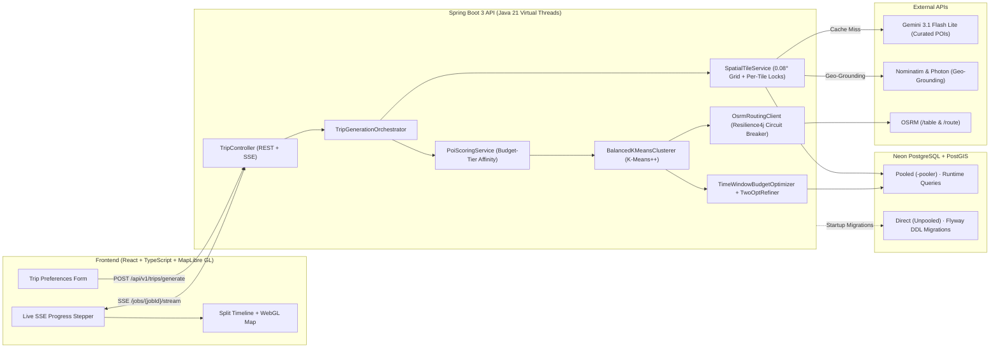

# RouteCraft — Constraint-Based Trip Planning Engine

[](https://routecraft-planner.netlify.app)
[](https://routecraft-backend-c9ci.onrender.com/swagger-ui.html)
[](https://openjdk.org/projects/jdk/21/)
[](https://spring.io/projects/spring-boot)
[](https://postgis.net/)

**RouteCraft** is a full-stack, constraint-optimized trip planning engine built with **Java 21 (Spring Boot 3)**, **PostgreSQL + PostGIS (Neon)**, **OSRM**, and **React + TypeScript + MapLibre GL**.

Unlike thin LLM itinerary wrappers that hallucinate locations, zig-zag across cities, and ignore budgets or opening hours, RouteCraft grounds community-curated venues against OpenStreetMap coordinates, caches them spatially in PostGIS, geo-clusters stops into compact daily zones, computes real driving-time matrices via OSRM, and runs a deterministic **Time-Window & Budget Heuristic Optimizer** with **2-Opt local search**.

- **Live App:** https://routecraft-planner.netlify.app
- **Swagger / OpenAPI:** https://routecraft-backend-c9ci.onrender.com/swagger-ui.html

---

## System Architecture



---

## Key Engineering Highlights

### 1. Spatial Tile Caching (`PostGIS + GIST`)
- Quantizes destinations into `0.08° × 0.08°` (~8.8 km) geographic tiles stored in `spatial_tiles` with a 7-day TTL and `GEOGRAPHY(Point, 4326)` `GIST` indexes on `pois`.
- Uses per-tile `ReentrantLock` double-checked locking to prevent cache stampedes on concurrent cold-city requests, and avoids negative-cache poisoning when upstream providers fail.
- Warm queries retrieve candidate POIs via `ST_DWithin` in ~15 ms with zero external POI API calls.

### 2. Multi-Source POI Discovery & Geo-Grounding
- Combines **Gemini community curation** (`gemini-3.1-flash-lite`) with **bounded OpenStreetMap verification** (Photon + Nominatim) running concurrently on **Java 21 Virtual Threads**.
- Discards out-of-bounds coordinates, deduplicates by normalized name and spatial proximity (`< 100 m`), and caches all 4 price tiers (street food → 5-star fine dining) per city.

### 3. Budget-Tier Affinity & Balanced Geo-Clustering
- **Dynamic Budget-Tier Matching (`PoiScoringService`):** Maps `totalBudget / (days × peopleCount)` to an ideal price tier (`1..4`) so a single cached city dynamically serves both budget backpackers and luxury travelers.
- **Capacity-Constrained K-Means++ (`BalancedKMeansClusterer`):** Clusters attractions into balanced, geographically compact daily zones via regret-ordered assignment, then assigns nearby restaurants/cafes to each day's centroid with zero cross-day duplicates.

### 4. Time-Window & Budget Optimizer + 2-Opt Refinement
- Schedules each day across pace-dependent windows (`RELAXED`, `MODERATE`, `PACKED`) with dedicated lunch (`12:00–14:30`) and dinner (`18:30–21:00`) slots, enforcing opening hours, locked stops, and hard daily budget caps.
- Refines stop sequences using **2-Opt local search** over batch OSRM `/table` driving-time matrices (with automatic **Resilience4j** circuit-breaker fallback to Haversine speed estimates).
- Supports interactive **Lock & Re-optimize** (`POST /api/v1/trips/{tripId}/days/{dayNumber}/reoptimize`) preserving user-locked stops in `< 500 ms`.

### 5. Cloud Postgres Engineering (Neon)
- Custom `NeonDatabaseEnvironmentPostProcessor` parses `DATABASE_URL` (`-pooler`) with `prepareThreshold=0` for PgBouncer transaction-mode compatibility and routes Flyway migrations to `DATABASE_URL_UNPOOLED` (direct connection).
- Enabled Hibernate JDBC batching (`batch_size=50`, `order_inserts=true`) with PostgreSQL `reWriteBatchedInserts=true`, eliminating cross-region row-by-row insert latency.

---

## Measured Performance & Behavior

| Scenario | Cold Cache | Warm Spatial Cache | Speedup / Notes |
| :--- | :---: | :---: | :--- |
| **Manali (3 days, 2 pax, ₹18,000)** | `18.9 s` | **`398 ms`** | **97.9% latency reduction** (`cacheHit=true`, OSRM routing, 15 stops) |
| **Hyderabad (2 days, 3 pax, ₹25,000)** | `25.1 s` | **`493 ms`** *(Re-optimize)* | 20 min total Day 1 transit across 6 Old City stops |
| **New Delhi — Budget vs. Luxury A/B** | ₹8,000 cap → **₹7,900** (*Cafe Lota, Kunzum, Dolma Momos*) | ₹18,00,000 cap → **₹71,600** (*Bukhara, Indian Accent, Wasabi*) | Both served from the **same PostGIS spatial cache** (`cacheHit=true`) |

---

## Tech Stack

| Layer | Technologies |
| :--- | :--- |
| **Backend** | Java 21 (Virtual Threads), Spring Boot 3.4, Spring Data JPA, Hibernate Spatial (JTS), Flyway, Resilience4j, Micrometer + Prometheus, SpringDoc OpenAPI |
| **Database** | PostgreSQL + PostGIS (Neon Cloud / Docker locally), GIST Spatial Indexes, JSONB |
| **Routing & Geo** | OSRM (`/table` & `/route`), Nominatim, Photon OSM, Gemini 3.1 Flash Lite |
| **Frontend** | React 19, TypeScript, Vite, Tailwind CSS v4, MapLibre GL (WebGL vector + Terrain + 3D + Satellite), EventSource (SSE) |
| **Deployment** | Netlify (Frontend), Render Docker (Java 21 Backend), Neon (PostGIS Database) |

---

## API Reference

| Method | Endpoint | Description |
| :--- | :--- | :--- |
| `POST` | `/api/v1/trips/generate` | Submit trip constraints (`202 Accepted` with `jobId` & `streamUrl`) |
| `GET` | `/api/v1/trips/jobs/{jobId}/stream` | Server-Sent Events (SSE) stream of pipeline stages & final `TripResponse` |
| `GET` | `/api/v1/trips/{tripId}` | Retrieve persisted trip (supports bookmarkable URLs & page refresh) |
| `PATCH` | `/api/v1/trips/{tripId}/stops/{stopId}` | Lock or unlock a stop |
| `DELETE` | `/api/v1/trips/{tripId}/stops/{stopId}` | Remove a stop and recalculate trip budget |
| `POST` | `/api/v1/trips/{tripId}/days/{dayNumber}/reoptimize` | Re-optimize a single day while preserving locked stops |
| `GET` | `/actuator/prometheus` | Micrometer metrics (`trip.tile_cache.hits/misses`, `trip.optimizer.duration`, `trip.osrm.duration`) |

---

## Local Development

### Prerequisites
- Java 21+ & Maven 3.9+
- Node.js 20+
- Docker (or a free [Neon](https://neon.tech) PostGIS connection string)

### 1. Start Database
Either run local PostGIS + Redis with Docker:
```bash
docker compose up -d
```
Or point `.env` at a Neon database (`DATABASE_URL` + `DATABASE_URL_UNPOOLED`).

### 2. Configure Environment (`.env`)
```bash
GEMINI_API_KEY=your_gemini_api_key
# Optional: override local Docker Postgres with Neon
# DATABASE_URL=postgresql://...
# DATABASE_URL_UNPOOLED=postgresql://...
```

### 3. Run Backend & Frontend
```bash
# Terminal 1 — Backend (http://localhost:8080)
set -a && source .env && set +a
cd backend && mvn spring-boot:run

# Terminal 2 — Frontend (http://localhost:5173)
cd frontend && npm install && npm run dev
```

### 4. Run Tests
```bash
cd backend && mvn test
cd frontend && npm run build
```
